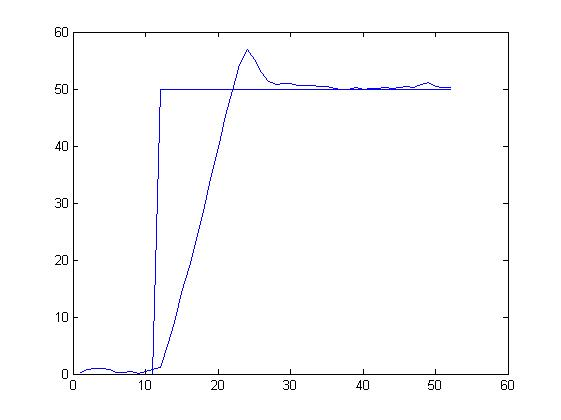
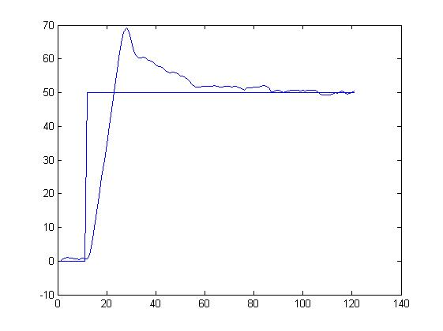
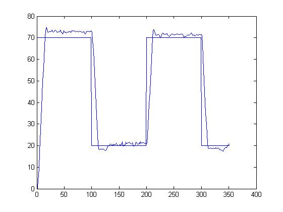
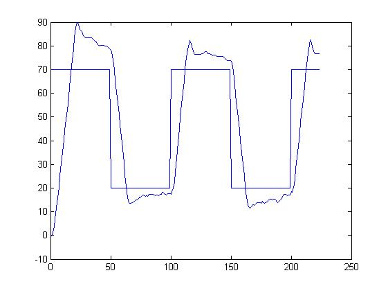
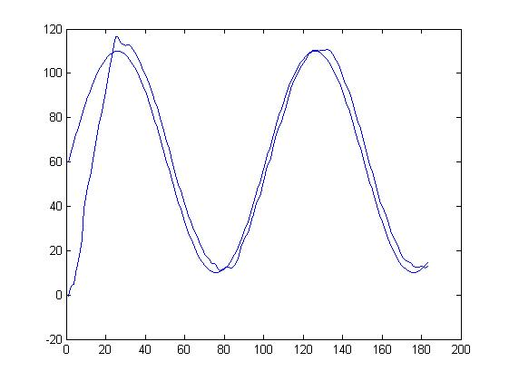
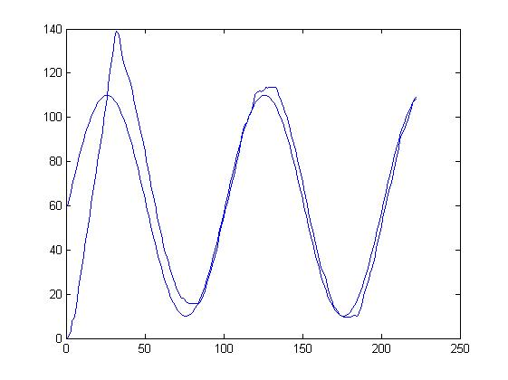

# 直流伺服电机位置闭环控制

2024 年机械制造综合课程设计：在一维位置控制实验台上，使用 AC6011 数据采集卡读取位移反馈，以增量式 PID 计算控制量，输出模拟电压驱动直流伺服电机，并在阶跃、正弦和方波目标下记录位置响应。

## 我的工作

- 在课程提供的控制程序模板上修改位置控制程序，调试采集卡 A/D 采样、D/A 输出和增量式 PID 控制。
- 亲自连接实验设备、调节 PID 参数，并记录目标位移和实际位移响应。
- 分析程序中的去极值平均滤波、输出限幅和死区处理；对不同输入和参数下的响应曲线进行比较。
- 结合课程设计说明书中的 MATLAB/Simulink 模型，对照仿真曲线与实验曲线。

实验平台、课程程序框架和采集卡配套驱动由课程／实验室提供。项目展示的是基于模板的控制程序修改、设备调试与实验分析。

## 系统结构

```text
目标位移 → 误差计算 → 增量式 PID → 限幅与死区处理 → AC6011 D/A
                ↑                                       ↓
                │                          驱动器 → 直流伺服电机
                │                                       ↓
        位移换算与滤波 ← AC6011 A/D ← 位移传感器 ← 减速器与丝杠
```

## 控制程序

查看 [AC6011_original.cpp](src/AC6011_original.cpp)：该文件从 2024 年课程设计说明书附录提取，保留原始代码，基于课程模板修改，主要采用 C 风格编写并使用部分 C++ 语法。

程序包含位置量换算、258 次采样去除最大值和最小值后求平均、增量式 PID、输出限幅、死区处理，以及目标与反馈位置的文件记录。

**运行条件与限制：**原程序依赖 Windows、AC6011 专用驱动与实验台；本仓库不提供厂商驱动和实验设备，未重新验证可编译或可在硬件上运行。程序中的 `t += 0.1` 并不证明实际控制周期为 0.1 秒。末尾包含驱动输出，未经安全检查不要连接真实设备运行。

## 实验曲线

以下图片保留自课程项目资料，均在说明书“系统实际运行结果”中出现，曲线由本人记录。参数按文件名和原报告标注；部分图缺少坐标轴名称、单位和实际采样间隔，暂不从图中推算控制周期、精度或性能提升。

### 阶跃响应

| PID = 40, 0.1, 0.1 | PID = 40, 5, 0.1 |
| --- | --- |
|  |  |

### 方波跟踪

| 振幅 50、周期 10、PID = 40, 0.1, 0.1 | 振幅 50、周期 5、PID = 40, 1, 0.1 |
| --- | --- |
|  |  |

### 正弦跟踪

| 振幅 50、周期 10、PID = 40, 0.1, 0.1 | 振幅 50、周期 10、PID = 40, 1, 0.1 |
| --- | --- |
|  |  |

## 仿真曲线

以下六张图片从说明书“仿真结果对比分析”章节提取：

| 输入 | 参数标注 | 曲线 |
| --- | --- | --- |
| 阶跃 | PID = 40, 0.1, 0.1 | [查看仿真图](images/simulation/step_pid40_0.1_0.1.png) |
| 阶跃 | PID = 40, 5, 0.1 | [查看仿真图](images/simulation/step_pid40_5_0.1.png) |
| 方波 | 振幅 50，周期 10，PID = 40, 0.1, 0.1 | [查看仿真图](images/simulation/square_a50_t10_pid40_0.1_0.1.png) |
| 方波 | 振幅 50，周期 5，PID = 40, 1, 0.1 | [查看仿真图](images/simulation/square_a50_t5_pid40_1_0.1.png) |
| 正弦 | 振幅 50，周期 10，PID = 40, 0.1, 0.1 | [查看仿真图](images/simulation/sine_a50_t10_pid40_0.1_0.1.png) |
| 正弦 | 振幅 50，周期 10，PID = 40, 1, 0.1 | [查看仿真图](images/simulation/sine_a50_t10_pid40_1_0.1.png) |

说明书中的仿真与实验图在部分工况下的给定幅值和横轴信息并不一致，不能据此直接比较绝对误差或计算性能提升；需要找到原始数据并统一测试条件后再定量分析。
